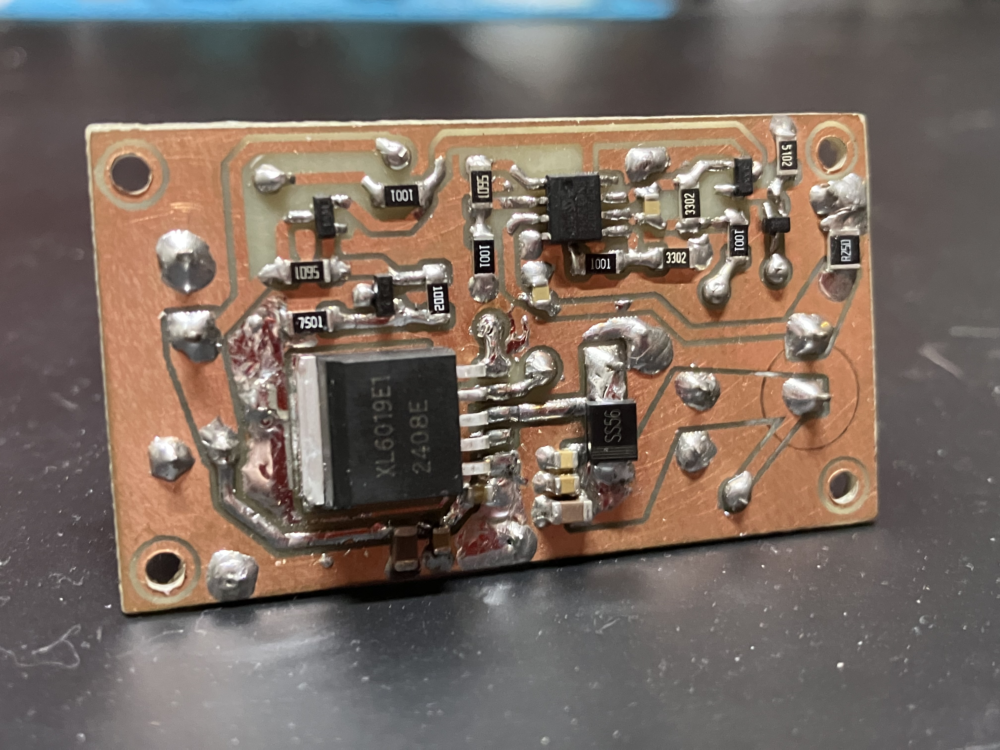
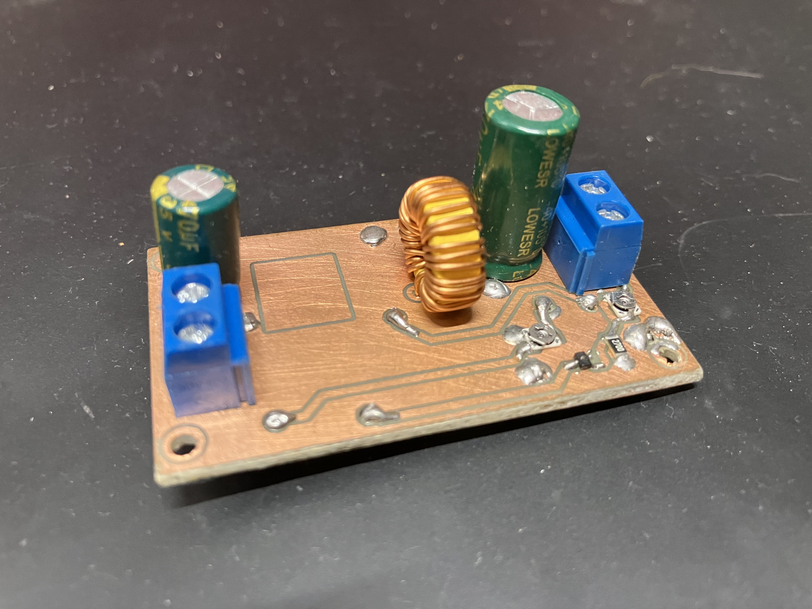

# XL6019-constant-current-laser-driver

*V1.3 completed May 17th, 2026*

A modified application of the XL6019, utilizing feedback from a low side shunt resistor for current controlled operation.

  
  

## Specifications

* **Boost converter IC:** XL6019E1 in TO-263-5L
* **Input range:** +5V to +35V
* **Output range:** +5V to +40V
* **Current regulation range:** 50mA to 2.72A

## Architecture

* A low side shunt resistor of value 0.25Ω is installed in series with the standard XL6019 boost circuit. This does mean the output terminal floats at a rate of +0.25V/A, however the converter is intended for driving a laser diode, so this is favorable over a more complex, high side shunt.

* The voltage at the current sense resistor is amplified by a non inverting amplifier with a gain of 6.6, resulting in a voltage of +4.5V at this node when the current is 2.72A. This signal goes into the non inverting input of a differential amplifier. The inverting input is connected to a potentiometer that ranges from 0V to +4.5V. The gain of the amplifier is 33, so if the current sense is just slightly above the target selected by the potentiometer, the op amp drives an MMBT3904 to bring the FB pin of the XL6019 up. This tricks the XL6019 into thinking its voltage is too high and thus lowers the output voltage until the requested current is met, and output voltage of the current sense circuitry equals the 1.25V reference inside the Xl6019. This allows the converter to regulate any positive current from 50mA to 2.75A so long as the load voltage is greater than the input voltage, and the load does not have a negative differential resistance.

* A 5V linear regulator is assembled using the AP431SANTR-G1 as the reference voltage for an MMBT3904 emitter follower from Vin

## Challenges

* Achieving stable feedback on a device that switches at 180kHz requires a carefully thought out feedback design. The network must be able to react fast enough to changes in the output current while preventing any oscillation in the feedback. A 10nF capacitor from the inverting input of the differential amplifier to its output acts as a low pass filter, lowering amplification of signals above ~482Hz. This drastically reduces the gain of higher frequencies, notably the switching frequency. Without this capacitor it is likely the circuit would oscillate.
   
* The device should be able to regulate voltage with one potentiometer, while seamlessly switching to constant-current regulation with another when the current limit is reached. This creates a natural priority in the signals, as the current regulation takes higher precedence than voltage regulation. This is achieved through a BAS16W diode. When the current sense signal at the emitter of the MMBT3904 is below 1.95V (XL6019 reference voltage + diode drop, the feedback voltage at the XL6019 is equal to the voltage divider feedback. When a current sense signal is present, the feedback voltage is pulled above the 1.25V reference through the diode and MMBT3904.

* To reduce conducted and radiated emissions, hot loops on the converter are minimized heavily. The tight placement of the 100nF decoupling capacitors on the input and output voltage relative to the XL6019 ground provide very low impedance paths to ground for high frequency signals. Larger bulk capacitors are also located nearby to filter lower frequency ripple. These capacitors aid to stabilize the output voltage and reduce interference that could harm other devices.
